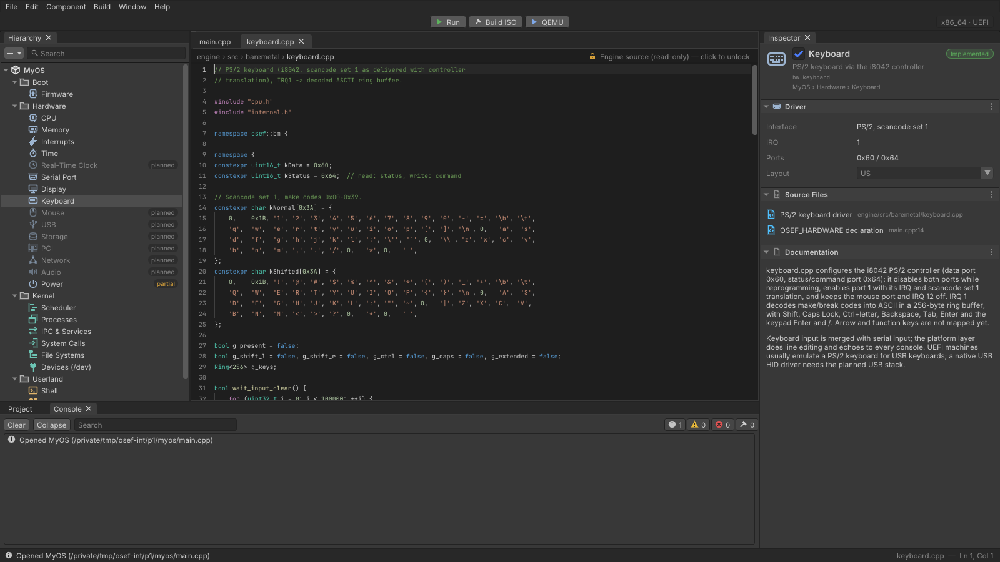

# OSEF Editor

A Unity-style desktop editor for OSEF operating systems. OSEF is an "operating
system engine": you compose an OS from reusable kernel parts, the way a game
engine composes a game. The editor shows that OS as a **Hierarchy** of components
(boot firmware, CPU, memory, devices, kernel subsystems, programs, modules). It
also has a **Code** editor with C++ highlighting, an **Inspector** whose bound
properties (⛓) rewrite the `OSEF_HARDWARE(...)` declaration in `main.cpp` live,
and a **Project** browser and **Console** at the bottom. The Console streams the
output of build and run jobs.

It is written in C++20 with Dear ImGui (docking branch), GLFW and OpenGL 3.2 core.
The desktop app uses a custom OSEF Editor icon.



The design is described in [ARCHITECTURE.md](ARCHITECTURE.md): layout, source
ownership, component catalog, data flow and colors.

Use **Appearance** in the menu bar to switch between beginner guidance and the
advanced experience, or choose the OSEF Dark, Light or High Contrast color theme.
These preferences are saved with the editor's panel and layout settings.

## Build and run

The dependencies are Dear ImGui, GLFW, Inter and JetBrains Mono. They are pinned
by sha256 and fetched into `editor/third_party/` by
`tools/bootstrap/editor-deps.sh`. `make` runs that script automatically the first
time.

**macOS / Linux (make):**

```sh
make -C editor                    # builds build/editor/osef-editor
make -C editor run                # opens examples/myos
make -C editor run ARGS="path/to/myos"
make -C editor test               # headless unit tests (model, text, services)
make -C editor test SANITIZE=1    # the same, with ASan + UBSan
make -C editor app                # macOS: build/editor/OSEF Editor.app
make -C editor install            # macOS: copy it to /Applications (or ~/Applications)
```

Linux needs the X11/Wayland development headers that GLFW requires, for example
`libx11-dev libxrandr-dev libxinerama-dev libxcursor-dev libxi-dev libgl-dev` on
Debian/Ubuntu.

**Any platform (CMake 3.16+):** this is the path to use on Windows (MSVC).

```sh
cmake -S editor -B build-editor -DCMAKE_BUILD_TYPE=Release
cmake --build build-editor --config Release
ctest --test-dir build-editor -C Release
build-editor/osef-editor examples/myos        # build-editor\Release\osef-editor.exe on Windows
```

If `editor/third_party/` is missing, CMake downloads the same pinned archives
with FetchContent. Windows support is written but has not been tested yet.

## App icon

`editor/assets/icon.png` is the icon on every platform: the macOS app bundle
and Dock, the Windows `.exe` (Explorer, taskbar), and the window icon on Linux.
To use your own artwork:

1. Save a square PNG (1024 x 1024 recommended, 8-bit, not interlaced) as
   `editor/assets/icon.png`. To convert a WebP on macOS:
   `sips -s format png my-icon.webp --out editor/assets/icon.png`.
2. Run `make -C editor icons`. It regenerates `assets/icon.ico` (Windows),
   `assets/OSEF.icns` (macOS; needs `iconutil`, so run it on a Mac) and
   `src/app/icon_data.inc` (the window icon compiled into the app).
3. Commit those files, then rebuild (`make -C editor app` on macOS).

The generated files are committed, so Windows and Linux builds and CI need no
image tools. The Linux release also ships `osef-editor.png` and
`osef-editor.desktop` for application menus.

## Command line

```
osef-editor [<project dir or main.cpp>] [--root <osef checkout>]
            [--screenshot <out.png>] [--size <W>x<H>] [--frames <N>]
            [--select <component id>] [--open <file>[:<line>]]
            [--set <component id>.<property id>=<value>]...
            [--toggle <component id>=on|off]...
```

* With no project argument, the editor opens `examples/myos`.
* `--screenshot` renders headlessly to a PNG (1600x900 by default) and exits. It
  never saves documents.
* `--set` and `--toggle` drive the Inspector's binding to the code. For example:

  ```sh
  osef-editor /tmp/myos --select os --set boot.firmware.firmware=BIOS \
      --toggle hw.keyboard=off --set hw.memory.memory_mb=256 --screenshot /tmp/x.png
  ```

  If `main.cpp` has no `OSEF_HARDWARE` declaration, the first bound edit inserts one.
* Exit codes: 0 on success, 1 if the project or a CLI edit failed (the PNG is still
  written), and 2 for bad arguments. `--help` lists everything.

## Shortcuts

On macOS the shortcuts use Cmd; on Windows and Linux they use Ctrl. Help > Keyboard
Shortcuts lists them in the app.

| Keys | Action |
|---|---|
| Cmd+S / Cmd+Opt+S | Save the active file / save all |
| Cmd+O | Open a project |
| Cmd+P | Run (hosted, `make run`) |
| Cmd+B | Build ISO (`make iso`) |
| Cmd+Shift+P | Run in QEMU (`make run-iso`) |
| Cmd+. | Cancel the running job |
| Cmd+F | Find in the active file (Enter / Shift+Enter for next / previous) |
| Cmd+Z / Cmd+Shift+Z | Undo / redo (code editor) |
| Cmd+/ , Cmd+Shift+K | Toggle comment, delete line |
| Tab / Shift+Tab | Indent / outdent the selection |
| Arrows, Home/End, Enter | Navigate the Hierarchy / open the source |
| Cmd+C in Console | Copy the selected log lines (double-click a `file:line` line to open it) |
| Cmd+Q | Quit (asks about unsaved changes) |

The Console sits at the bottom, next to Project. You can also open it from
Window > Console, or bring it to the front by clicking the status bar.

## Extending

* **New component:** add it in `src/model/component_catalog.cpp`. If it binds to
  the hardware declaration, extend `HardwareDecl` (`src/model/hardware_decl.*`) and
  `Project::apply_property`.
* **New panel:** subclass `Panel` (`src/app/panel.h`) and register it in the
  `EditorApp` constructor. It shows up in the Window menu automatically.
* **New build target:** add it in `Project::build_targets()`.
* **Planned hardware:** "Create Driver Stub…" in the Inspector or the Hierarchy's
  context menu writes `drivers/<id>.cpp` into the OS project as a starting point.

The `src/model`, `src/text`, `src/services` and `src/util` directories never
include ImGui or OpenGL. Unit tests for them go in `tests/`, and new
`src/*/*.cpp` files are picked up by the Makefile automatically.
